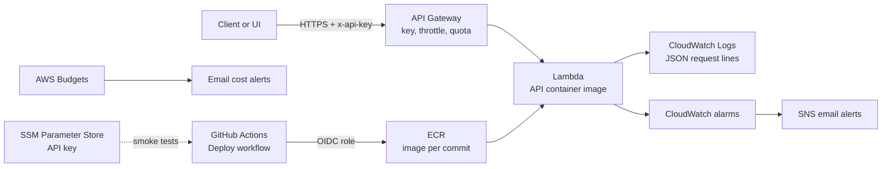

# FastAPI Machine Learning Model Deployment

This project implements a RESTful API using FastAPI to deploy a machine learning model for predicting home prices based on various features. The model is trained on real estate data and can provide predictions based on user input.

## Main Differences

This is an MLOps refactor of the original service, not a data-science one. The model was not retrained, and `model.pkl` is the original file. What changed is how the model is served:

- **Missing data**: `/predict` accepts `null` (or omitted) values for every house field except `zipcode`, and fills them with a KNN imputer.
- **Performance**: the model, feature list and demographics are loaded once at startup instead of on every request.
- **Validation and errors**: an unknown or missing zipcode returns a clear 422 instead of a failed prediction.
- **Batch endpoint**: `/predict/batch` prices a list of houses with one model call.
- **Logging**: one JSON line per request (path, status, latency, zipcode).
- **Dependencies**: locked with `uv` (`pyproject.toml` and `uv.lock`), with scikit-learn pinned to the version that created `model.pkl`.
- **Tests and CI**: tests for imputation, validation and the load-once behaviour; GitHub Actions runs lint and the full Docker test suite.
- **Optional extras**: a small Streamlit UI and an AWS deployment with Terraform.

To show that the refactor did not change the model's behaviour, the predictions of the original service on `future_unseen_examples.csv` were saved as a golden reference. After each change, the same rows were sent to the new service and the results were diffed against that reference. The holdout evaluation (`scripts/evaluate_api.py`) was compared the same way.

## Project Structure

```
mle-project-challenge-2026
├── src
│   ├── main.py                # Entry point for the FastAPI application
│   ├── api
│   │   └── endpoints.py       # API endpoints for predictions
│   ├── model
│   │   ├── model.pkl          # Serialized machine learning model
│   │   ├── model_features.json # Features required for predictions
│   │   ├── imputer.pkl        # KNN imputer for missing house fields
│   │   ├── create_imputer.py  # Fits imputer.pkl on the model's training split
│   │   ├── evaluation.py      # Shared train/holdout split and metrics
│   │   └── evaluate_model.py  # Scores a model file on the holdout rows
│   ├── data
│   │   ├── kc_house_data.csv  # Training data for the model
│   │   ├── zipcode_demographics.csv # Demographic data for predictions
│   │   └── future_unseen_examples.csv # Examples for testing the API
│   └── utils
│       └── loader.py          # Utility functions for loading the model
├── scripts                     # Benchmark, profiling and evaluation tools
├── ui
│   └── app.py                 # Optional Streamlit front end
├── infra                       # Optional AWS deployment (Terraform)
├── .github/workflows           # CI and manual deploy
├── requirements.txt            # Project dependencies
├── requirements-test.txt       # Test dependencies
├── pyproject.toml              # Project dependencies (used by uv)
├── uv.lock                     # Locked dependency versions
├── Dockerfile                  # Docker instructions for deployment
├── Dockerfile.test             # Docker instructions for the test image
├── docker-compose.test.yml     # API and test containers for integration tests
├── Makefile                    # Test, lint and benchmark targets
├── README.md                   # Project documentation
└── test
    ├── conftest.py            # Shared fixtures
    ├── unit                   # Unit tests (TestClient)
    └── integration            # Integration tests against the running container
```

## Setup Instructions

### Prerequisites

- Docker installed on your system
- Git (for cloning the repository)
- Optional: [uv](https://docs.astral.sh/uv/), for linting, the scripts and the UI outside Docker

### Step 1: Clone the Repository

```bash
git clone <repository-url>
cd mle-project-challenge-2026
```

### Step 2a: Generate Model Artifacts (First Time Only)

Before running the API, you need to generate the model files. This only needs to be done once, or when you want to retrain the model.

**Build the model creation Docker image:**
```bash
docker build -f src/model/Dockerfile -t create-model .
```

**Run the container to generate model artifacts:**
```bash
docker run --rm -v "$(pwd)/src/model:/app/model" create-model
```

This will create `model.pkl` and `model_features.json` in the `src/model/` directory.

### Step 2b: Regenerate Model Artifacts

The artifacts, including `imputer.pkl`, are committed, so this is only needed to rebuild them.

**Model** (same as Step 2a, as one Makefile target):
```bash
make train-model
```

**Imputer** (run with `uv` so it uses the locked scikit-learn version):
```bash
cd src/model && uv run python create_imputer.py
```

This will create `imputer.pkl` in the `src/model/` directory.

### Step 3: Build and Run the API

**Build the API Docker image:**
```bash
docker build -t mle-project-challenge-2026 .
```

**Run the API container:**
```bash
docker run -d -p 8000:8000 --name housing-api mle-project-challenge-2026
```

### Step 4: Access the API

Open your browser and go to `http://127.0.0.1:8000/docs` to view the interactive API documentation.

### Managing the Container

**Stop the container:**
```bash
docker stop housing-api
```

**Start the container again:**
```bash
docker start housing-api
```

**Remove the container:**
```bash
docker rm housing-api
```

**View container logs** (one JSON line per request):
```bash
docker logs housing-api
```

## Usage

To get predictions from the model, send a POST request to the `/predict` endpoint with the features in JSON format. `zipcode` is required; any other field can be `null` or left out.

```bash
curl -X POST http://127.0.0.1:8000/predict \
  -H "Content-Type: application/json" \
  -d '{"bedrooms": 3, "bathrooms": null, "sqft_living": 2000, "sqft_lot": null,
       "floors": 2, "sqft_above": 1500, "sqft_basement": 500, "zipcode": "98125"}'
```

The API returns the predicted home price (`predicted_price`) and the values it filled in (`imputed_fields`, which is `{}` when nothing was missing).

| Endpoint | Purpose |
|---|---|
| `GET /health` | Readiness check, used by Docker Compose and AWS |
| `POST /predict` | One house. A missing zipcode, a zipcode without demographics data, or a wrongly typed field returns 422 with a message |
| `POST /predict/batch` | A list of houses. Each item gets either a result or an `error`, so one bad row doesn't fail the others |

### Missing-Data Handling

Missing house fields are filled with scikit-learn's `KNNImputer`, as recommended in `notebooks/imputation_experiment.ipynb`:

- It uses the notebook's settings (`n_neighbors=5`, `weights="distance"`) on the 7 house fields the API receives.
- It is fit only on the model's training split, so evaluation rows are never used as neighbours. It is saved as `src/model/imputer.pkl` and loaded at startup with the model.
- For a request with gaps, the API fills them from the most similar training houses, then predicts as usual. Complete requests skip the imputer, so their prices are unchanged.
- The neighbour pool is fixed, so a house gets the same result alone or in a batch. A request with every house field missing falls back to the training averages.

## Performance

The main bottleneck was in the request path: every request unpickled the model, re-read the features file and re-parsed the demographics CSV. The changes:

- Load the model, feature list, demographics and imputer once at startup (FastAPI lifespan).
- Index the demographics by zipcode, so building a request row is a single lookup.
- Remove `--reload` from the container command and the `print` in the endpoint.
- Add `/predict/batch` for clients that price many houses at once.

Both Docker images set `OMP_NUM_THREADS=1` so that predictions are reproducible across machines. To measure an image (latency, throughput and cold start, in a container limited to 1 CPU and 2 GB):

```bash
docker build -t housing-api:current .
make benchmark IMAGE=housing-api:current LABEL=current   # writes reports/benchmark/current.json
```

## Dependencies

Dependencies are declared in `pyproject.toml` and locked in `uv.lock`. The Docker images install them with `uv sync --locked`. `scikit-learn` is pinned to 1.7.2, the version that created `model.pkl`. Test and development tools (pytest, httpx, ruff, pyinstrument) are in the `dev` group and the UI's (Streamlit) in the `ui` group, so neither is installed in the API image.

## Testing

This project uses Docker-based testing to ensure environment consistency between testing and production. All tests run inside Docker containers, eliminating "works on my machine" issues.

### Quick Start

Run unit tests (fast, recommended for development):
```bash
make test-unit
```

Run integration tests (full environment):
```bash
make test-integration
```

Run all tests:
```bash
make test-all
```

Run lint (Ruff) and all tests, as CI does:
```bash
make ci
```

### Test Types

**Unit Tests** (`test/unit/`)
- Use FastAPI TestClient for in-process testing
- No external dependencies or containers required
- Cover predictions, validation errors, the batch endpoint, every combination of missing fields, the imputer, and loading the artifacts only once
- Fast execution (typically under 30 seconds)
- Ideal for rapid development iteration

**Integration Tests** (`test/integration/`)
- Test against a real running API container
- Verify end-to-end functionality via HTTP requests, including a request with `null` fields
- Ensure Docker networking and orchestration work correctly
- More comprehensive but slower execution

**Golden predictions and evaluation** (`scripts/`)
- `send_examples.py --out <file>` saves the API's predictions for `future_unseen_examples.csv`, to diff against the golden reference
- `evaluate_api.py` sends the holdout rows to a running API and reports accuracy metrics

### Running Tests

#### Unit Tests Only

```bash
make test-unit
```

This command:
- Builds the test Docker image
- Runs only tests in `test/unit/` directory
- Generates coverage reports
- Completes quickly without starting the full API container

#### Integration Tests Only

```bash
make test-integration
```

This command:
- Builds both API and test containers using Docker Compose
- Starts the API container and waits for health check
- Runs tests in `test/integration/` directory
- Automatically stops and removes containers when complete

#### All Tests

```bash
make test-all
```

Runs both integration and unit tests for comprehensive validation.

### Viewing Coverage Reports

After running tests, coverage reports are generated in the `test-results/` directory:

**HTML Coverage Report:**
```bash
open test-results/coverage/index.html
```

**Terminal Coverage Summary:**
Coverage is automatically displayed in the terminal after test execution.

### Running Specific Tests

Run a specific test file:
```bash
docker run --rm ml-api-test pytest test/unit/test_api_unit.py -v
```

Run a specific test function:
```bash
docker run --rm ml-api-test pytest test/unit/test_api_unit.py::test_predict_endpoint_valid_input -v
```

Run tests matching a pattern:
```bash
docker run --rm ml-api-test pytest test/unit -k "predict" -v
```

### Troubleshooting

**Issue: "Cannot connect to the Docker daemon"**

Solution: Ensure Docker is running on your system.
```bash
docker ps  # Should list running containers without error
```

**Issue: Integration tests fail with connection errors**

Solution: Check if the API container is healthy.
```bash
docker compose -f docker-compose.test.yml up
# In another terminal:
docker compose -f docker-compose.test.yml ps
docker compose -f docker-compose.test.yml logs api
```

**Issue: Tests pass locally but fail in Docker**

Solution: This usually indicates environment differences. Check:
- Model artifacts exist in `src/model/` (including `imputer.pkl`)
- Data files exist in `src/data/`
- `uv.lock` matches `pyproject.toml` (`uv lock --check`)

**Issue: "Port 8000 already in use"**

Solution: Stop any running containers or services using port 8000.
```bash
docker compose -f docker-compose.test.yml down
docker rm -f housing-api  # If the main API is running
```

**Issue: Test results not appearing in `test-results/` directory**

Solution: Ensure the directory exists and has proper permissions.
```bash
mkdir -p test-results
chmod 755 test-results
```

**Issue: Tests are very slow**

Solution: Run unit tests only for faster feedback during development.
```bash
make test-unit  # Much faster than integration tests
```

**Issue: "Image not found" errors**

Solution: Build the test image explicitly.
```bash
make test-build
```

### Cleaning Up

Remove test containers and artifacts:
```bash
make clean
```

This removes:
- All Docker containers created by docker-compose.test.yml
- All test result files and coverage reports

### Development Workflow

For rapid development iteration:

1. Make code changes in `src/` or test changes in `test/`
2. Run unit tests: `make test-unit`
3. Fix any issues and repeat
4. Before committing, run lint and the full suite: `make ci`

`make test-integration` rebuilds the API image, so integration tests always run against the current code. GitHub Actions runs the same checks on every pull request.

## Optional: Local UI

`ui/app.py` is a small Streamlit page for trying the API without writing JSON: enter what you know about a house, leave the rest empty, and it shows the estimate and the filled-in values. With the API running on port 8000:

```bash
uv run --group ui streamlit run ui/app.py
```

Set `API_URL` to point it at another API (for example the AWS one), `API_KEY` for the key that API requires, and `UI_PASSWORD` to add a password prompt.

## Optional: Cloud Deployment (AWS)

Cloud deployment isn't part of the challenge, but the same API image that runs locally also runs on AWS, defined with Terraform in `infra/`. It uses pay-per-use services, so an idle deployment costs close to nothing.



- **Lambda** runs the unchanged API image. The only change to the `Dockerfile` is the Lambda Web Adapter, which does nothing when the container runs locally.
- **API Gateway** is the only entry point. It checks the API key and applies throttling and a quota before a request reaches Lambda.
- **ECR** stores one immutable image per commit, which also allows rollback to a previous image.
- **CloudWatch** keeps the JSON request logs, with alarms for errors, slow requests and traffic spikes; **AWS Budgets** sends cost alerts.
- **GitHub Actions** deploys on demand (`deploy.yml`) with short-lived OIDC credentials, then runs smoke tests against the live API. CI also checks `terraform fmt` and `validate`.

Terraform state is kept in an S3 bucket created once by hand (see `infra/providers.tf`). The Lambda needs an image in ECR before it can be created, so the first apply is done in two steps:

```bash
cd infra
terraform init
terraform apply -target=aws_ecr_repository.api   # then build and push the first image
terraform apply
```

After that, deploys go through the Deploy workflow, and `terraform destroy` removes everything.

## Feedback

We welcome any feedback regarding the project or the interview process. Your insights are valuable to us as we strive to improve the experience for future candidates.
